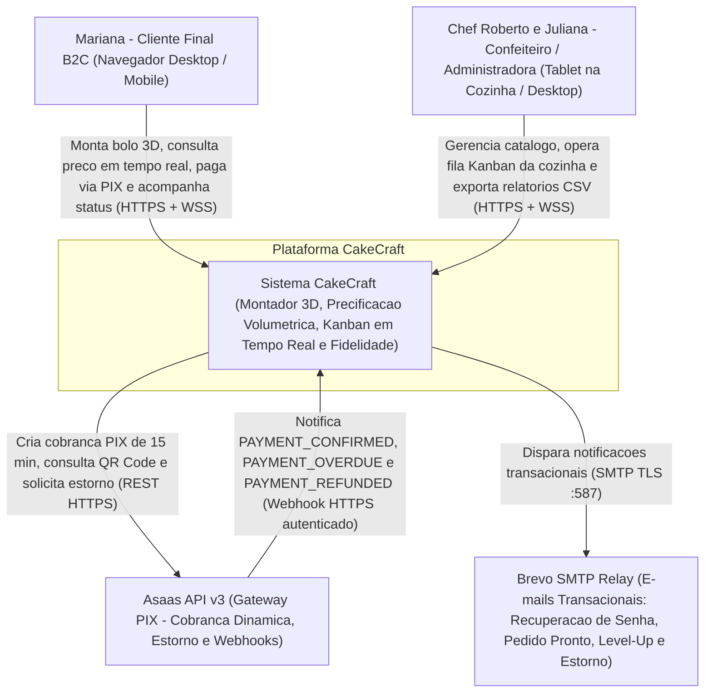
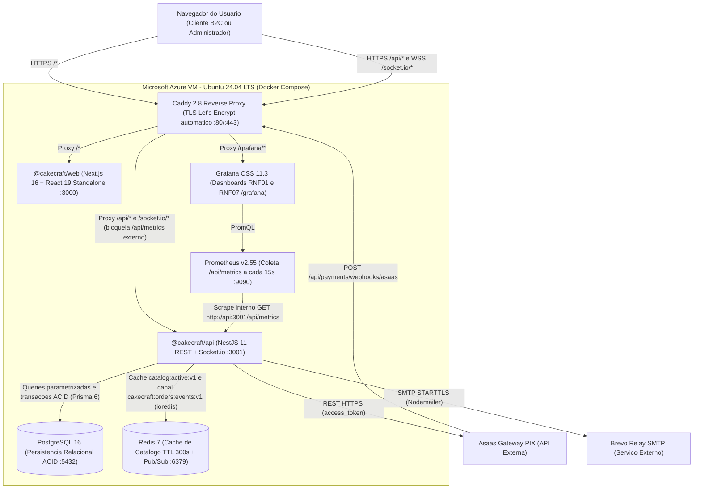
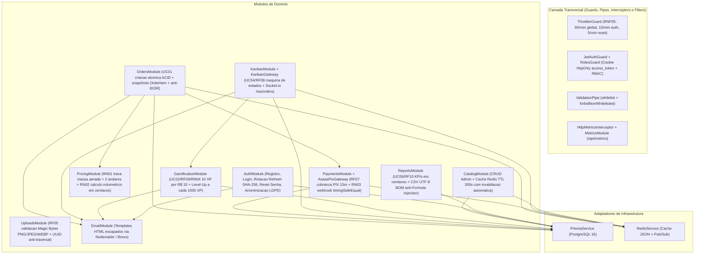
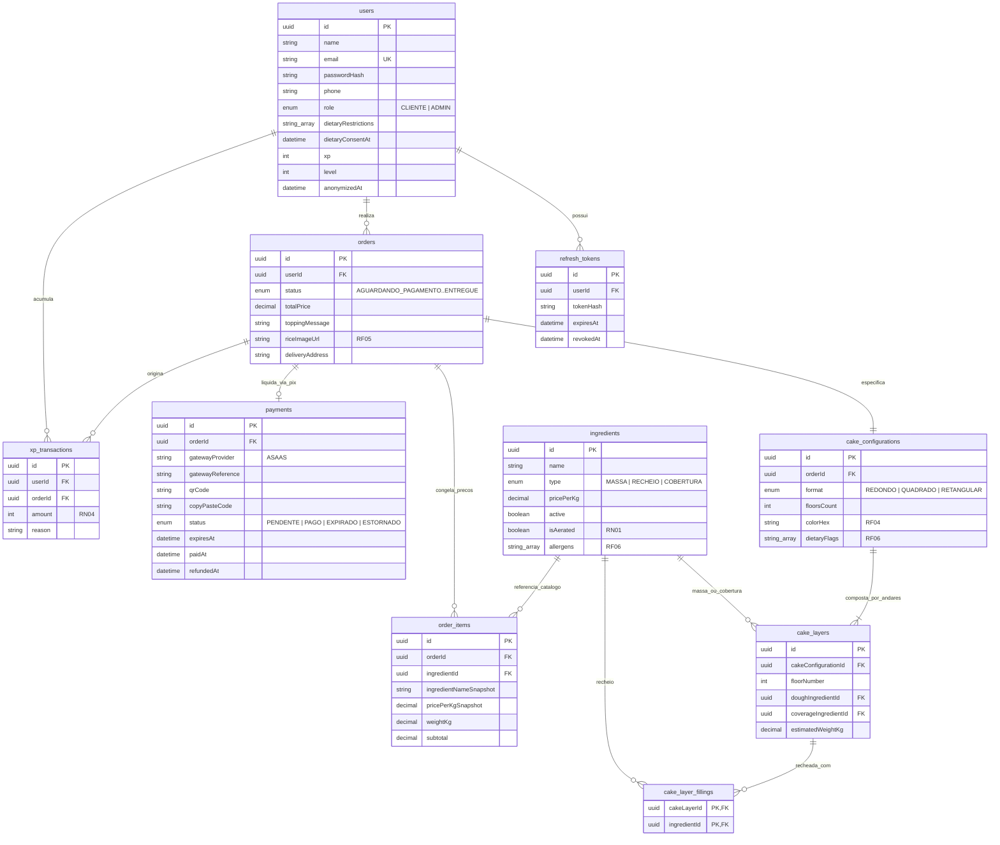
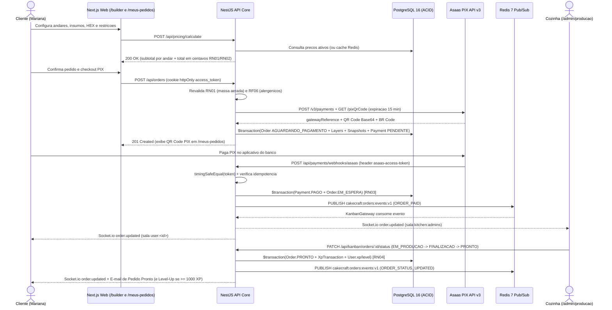

# Arquitetura do Sistema CakeCraft (Modelo C4, Modelo de Dados e Sequencia)

Este documento formaliza os diagramas arquiteturais referenciados nas **Secoes 3.1, 5.1 e 5.2** do `docs/RFC-001-CakeCraft.md`, versionados como codigo em Mermaid para rastreabilidade em Git e publicacao direta na Wiki do GitHub.

---

## 1. C4 Nivel 1 - Diagrama de Contexto

Mostra o sistema **CakeCraft** como caixa-preta, seus atores humanos (Personas da Secao 2.1 do RFC) e os sistemas externos integrados via rede.

---

## 2. C4 Nivel 2 - Diagrama de Containers (Topologia Microsoft Azure)

Detalha os containers Docker orquestrados em producao (`docker-compose.prod.yml`) sobre uma VM Linux Ubuntu 24.04 LTS provisionada via Terraform no **Microsoft Azure (`brazilsouth`)**.

---

## 3. C4 Nivel 3 - Componentes Internos da API Core (`@cakecraft/api`)

Mapeia os modulos internos do backend NestJS, suas fronteiras de seguranca e dependencias.

---

## 4. Modelo de Dados Relacional (Secao 5.2 do RFC - `schema.prisma`)

Representa todas as 9 tabelas persistidas no PostgreSQL 16, destacando chaves primarias, chaves estrangeiras e os snapshots historicos (`order_items`) que isolam pedidos fechados contra reajustes futuros no catalogo.

---

## 5. Diagrama de Sequencia - Pedido, PIX Asaas, Kanban Socket.io e Gamificacao (Secao 3.1)

Demonstra a integracao ponta a ponta desde a montagem no `/builder` ate a entrega na cozinha e credito de XP.

